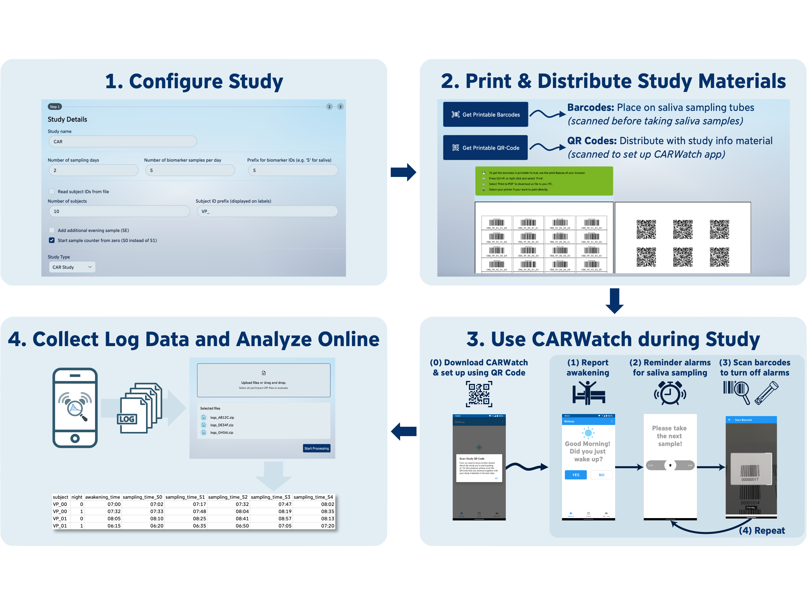

# Welcome to CARWatch!

CARWatch is an open-source framework for objective saliva sampling studies. It combines mobile apps for recording sample events with a web-based Study Manager for study preparation and log processing, and R and Python packages for processing logs and analysing saliva data.

Start with the [getting-started guide](/getting-started/) or [open the Study Manager](https://carwatch-tools.github.io/study-manager/).

## Purpose

CARWatch aims to support objective and low-cost saliva sampling in real-world, unsupervised settings. It is intended to reduce reliance on self-reported timestamps alone and to support better protocol adherence in field studies.

## What CARWatch Includes

- mobile apps for reminder-based sampling support and barcode-based recording of sample events
- web-based tools for study configuration, barcode and QR-code generation, and log processing
- R and Python packages for processing sampling logs and analysing saliva data
- preparation of study materials for data collection
- structured output for downstream analysis

## Workflow

Researchers can use CARWatch to:

1. configure a study
2. generate barcodes and QR codes
3. distribute materials to participants
4. collect objective sampling timestamps through the mobile app
5. process exported log files in the Study Manager or with the R and Python packages, and combine sampling records with laboratory saliva measurements

## Further Information

- [Get started](/getting-started/)
- [Overview](/overview/)
- [Components](/components/)
- [Publications](/publications/)
- [Privacy policy](/privacy/)
